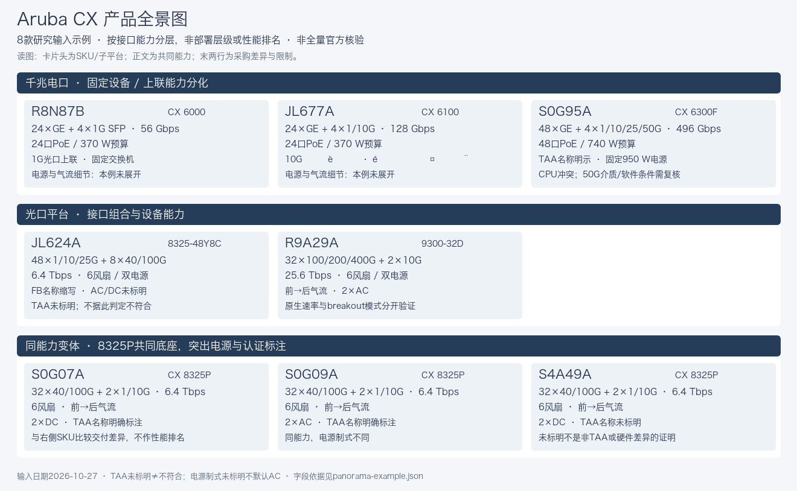

# Enterprise Network Product Research

企业网络产品研究技能：用数通/交换机领域知识组织产品身份、参数证据和配置条件，推进未知与冲突，输出可续研数据及图文报告。它是代理执行规范和辅助校验工具，不是一键联网爬取应用。

## 适用场景

- 厂商硬件产品清单、基础SKU与订货身份研究；排除Bundle、服务/包装项及其子SKU，保留排除依据，不计入产品表和图。
- 端口、Combo、多速率、breakout、PoE及模块化配置复核。
- 更新已有产品表，保留用户修正、历史证据和变化记录。
- 生成系列视图、同能力SKU差异分析及飞书友好的综合报告。

单参数查询按需简化，不自动扩成全景研究。产品页存在不证明在售，目录未检索到也不证明停售。

## 使用

将整个目录放到宿主支持的技能目录（例如 `~/.claude/skills/enterprise-network-product-research/`），保留相对路径。在支持技能调用的宿主中调用 `enterprise-network-product-research`，或由宿主按SKILL.md中的描述匹配。

请求示例：

> 基于这份交换机CSV继续研究，保持列名和顺序。按基础SKU复核接口、PoE和官方冲突，生成可供AI续研的底稿、全景图和综合报告；未确认的销售状态单列。

厂商/类别等必要条件无法确定时集中澄清；其他条件可说明默认值后执行。全量任务以JSON为唯一底稿，CSV及报告从同一快照派生。用户已有模板时，主表严格保留列名、列数及顺序，状态与证据放字段明细。

## 专家判断与证据

对目标字段依次判断直接事实、领域推导、条件结论和真正未知。完整接口模型能排除的能力可填0，无需每个速率都有厂商否定句；未知不填0，连接器形态不证明所有兼容速率。推导保留输入、规则、配置及限制，不冒充官方直接记载。

同端口/容量SKU必须突出气流、电源、认证、代际或交付差异；未标TAA不等于不符合，2 PSU不默认AC。CPU/ASIC、发布日期及在售状态不能靠接口知识猜测。

## 交付

- `research.json`：身份、配置、判断、证据、任务、覆盖和变化。
- `products.csv`及系列视图：用户模板；默认UTF-8 BOM。
- `claims.csv`、问题与变化清单：便于复核和AI接续。
- Markdown报告、SVG源图、同源PNG及manifest。

A图使用速率/形态泳道与SKU卡片，B图使用能力/变体矩阵。参考仅说明信息结构，不参考其风格/配色；实际视觉由Agent运用前端设计能力独立设计。示例含历史Bundle记录，不代表当前纳入清单，实际研究应排除这些项。参考是独立生成的Aruba八型号研究输入示例，不是完整目录、官方背书或已全面核验的产品规格：



[示例说明与重建](references/panorama-example.md) · [示例数据](references/panorama-example.json)

飞书默认只准备本地包；上传/创建文档需授权，导入链路及回读未测试时明确not_tested。SVG可编辑不等于飞书原生可编辑或可直接嵌入。

## 依赖与验证

数据校验和测试仅需Python 3标准库：

```sh
python3 -B -m unittest discover -s tests -v
python3 -B -m unittest discover -s tests -p test_validate_research.py -k critical_unknown -v
python3 -I -B scripts/validate_research.py /path/to/research.json
```

重建参考PNG额外需要ImageMagick和运行环境合法可用的中文无衬线字体：

```sh
python3 -I -B scripts/render_panorama_example.py --font /path/to/chinese-sans-font.ttf
```

字体不随仓库分发。真实研究需要宿主可用的搜索/网页/PDF工具；飞书操作需要相应连接器/技能及认证。前端设计技能可用时按其排版规范执行；不可用时遵循本技能参考文档，不虚构工具调用。

最小校验器不证明来源真实性、算术正确、目录完整或图表语义。`tests/scenarios.md`是行为验收用例，存在用例不代表全部已实际通过。网络获取、图形视觉检查与飞书导入需要独立验证。

## 发布边界

本目录忽略本地运行产物、完整中间表、过程笔记和本机缓存。参考图由Aruba示例数据独立生成，保留masked文件名仅为引用兼容。不要将客户资料、私有产品规划或其脱敏衍生图混入公开提交。历史三行CSV含已知缺陷，仅作迁移练习，见其配套说明。
